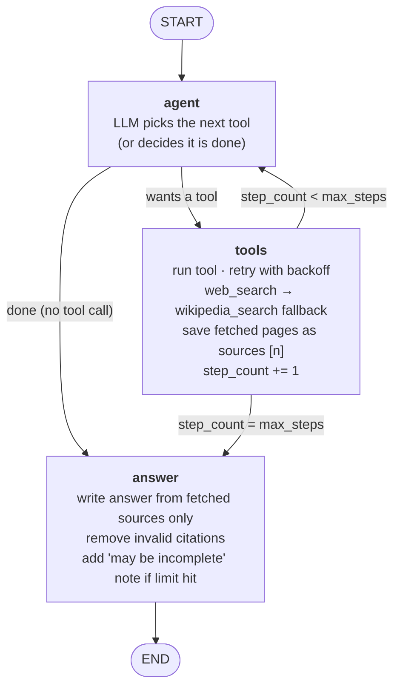

# Cited Research Agent

An AI agent that answers a research question by **searching the web, reading pages, and citing its sources**.
Every claim in the answer has a numbered citation like `[1]`, and every number points to a page the agent actually downloaded.

Built for the AgenticX *AI Agents & Automation* internship, Brief 1: Tool-Using Research Agent.

```bash
python -m agent "What are the health effects of intermittent fasting?"
```

See [Example runs](#example-runs) for real output.

## What it does

1. You ask a question.
2. The LLM (Google Gemini) **chooses tools** one step at a time:

   | Tool | What it does | Can it be cited? |
   |---|---|---|
   | `web_search` | Searches the web with DuckDuckGo (`ddgs` package, no API key) | No, it only returns snippets |
   | `wikipedia_search` | Searches Wikipedia (free MediaWiki API, no key). Also the automatic backup for `web_search` | No, it only returns snippets |
   | `fetch_page` | Downloads a URL and extracts the clean main text | **Yes**, the page becomes source `[n]` |
   | `summarise_page` | Downloads a URL and has the LLM summarise it for a focus topic | **Yes**, the page becomes source `[n]` |

3. When it has enough evidence, or hits the **step limit (8 tool calls)**, it writes the answer using **only** the downloaded pages.
4. A plain-Python check deletes any citation number that isn't a downloaded page, so made-up citations cannot survive.
5. Every step is logged (tool, input, success/failure, attempts, fallback) and each run is saved as JSON in `runs/` for later evaluation.

## How it works (LangGraph)

The agent is a small **state machine**. The state is a dictionary that every node reads and updates:
`question`, `messages`, `sources`, `step_count`, `max_steps`, `tool_log`, `errors`, `usage`, `limit_reached`, `answer`.



## Setup

You need Python 3.11+ and a free Google Gemini API key.

```bash
# 1. Create a virtual environment and install dependencies
python3 -m venv .venv
source .venv/bin/activate
pip install -r requirements.txt

# 2. Add your API key (get one free at https://aistudio.google.com/apikey)
cp .env.example .env
#    then open .env and replace "your-key-here" with your key

# 3. Ask a question
python -m agent "What are the health effects of intermittent fasting?"
```

Options:

```bash
python -m agent "question" --max-steps 5   # change the step limit
python -m agent "question" --json          # print the full result as JSON
python -m agent "question" --quiet         # hide the step-by-step log
```

The model is set with `GEMINI_MODEL` in `.env` (default `gemini-3.5-flash-lite`: fast and free. `gemini-2.5-flash` is no longer offered to new API keys, and `gemini-3.8-flash` was often overloaded with `503 high demand` errors during testing).

### Use it from Python (for the evaluation harness)

```python
from agent import run_agent

result = run_agent("Is coffee good for you?", max_steps=8)
result["answer"]        # the cited answer
result["sources"]       # [{id, url, title, tool, cited}], only pages that were fetched
result["steps"]         # number of tool calls used
result["tool_calls"]    # one log entry per tool call (see below)
result["errors"]        # every failed attempt, including retries
result["token_usage"]   # {input_tokens, output_tokens, total_tokens, llm_calls}
result["limit_reached"], result["citation_check"], result["duration_s"]
```

`run_agent` **never raises**. If something goes badly wrong, the problem is reported in `errors` and `answer`.

Each `tool_calls` entry has this shape (values are illustrative):

```json
{"step": 1, "tool": "web_search", "input": {"query": "intermittent fasting"},
 "success": true, "attempts": 3, "error": null,
 "search_tool_used": "wikipedia_search",
 "fallback_reason": "web_search failed after 2 retries (search failed: No results found.) -> fell back to wikipedia_search",
 "source_id": null, "duration_s": 4.1}
```

### Bonus: web API

```bash
uvicorn agent.api:app --reload
curl -X POST localhost:8000/ask -H 'Content-Type: application/json' \
     -d '{"question": "Is coffee good for you?"}'
# -> {"answer": "...", "sources": [...], "steps": [...]}
```

## How failures are handled

The rule is **never crash**: every failure becomes a message the LLM can react to, plus a log entry.

| What goes wrong | What the agent does |
|---|---|
| **Any tool fails** (exception or empty result) | Retries **once** after 1 second. If it fails again, the LLM gets `ERROR: fetch_page failed after 2 attempt(s): HTTP 404. Try a different URL...` and picks another source. |
| **DuckDuckGo blocks us** (HTTP 202 bot challenge) or returns nothing | `ddgs` runs with `backend="auto"`, so it tries other engines first. `web_search` gets **2 retries with backoff** (wait 1s, then 2s). |
| **`web_search` still fails after its retries** | Automatically runs **`wikipedia_search`** with the same query, inside the same step. The log records `search_tool_used: "wikipedia_search"` and `fallback_reason: "web_search failed after 2 retries (...) -> fell back to wikipedia_search"`. |
| **Both searches fail** | The LLM is told both failed and to try a simpler query. If no page is ever fetched, the answer says honestly *"I couldn't find and download any sources..."* with **no citations**. |
| **Page timeout** (15 s), **404/500**, **403/429 blocked**, **PDF/non-HTML**, **cookie wall / almost no text** | `fetch_page` raises a clear `ToolError` (`timed out`, `HTTP 404`, `blocked by the site (HTTP 403)`, `unsupported content type`, `page is empty or blocked`), and the retry rule above applies. |
| **LLM tries to stop before fetching any page** (seen in a real run after a 403) | If steps are left, it gets **one** reminder: *"You have not fetched any page yet, so nothing can be cited..."*. Sent only once, so it can't cause a loop. |
| **Same URL requested twice** | Not downloaded again. The LLM is told `Already fetched as source [n]`. |
| **LLM asks for an unknown tool or sends bad arguments** | Logged as a failed step. The agent carries on. |
| **Gemini API fails** (rate limit, network) | Research stops and the agent answers from whatever it has already fetched. If the final answer call fails, it lists the fetched sources instead. |
| **Endless loop** | Hard limit of `max_steps` tool calls (default 8), counted in the state. Extra calls are skipped, the graph goes to `answer`, and the answer ends with *"Note: I stopped after the 8-tool-call limit, so this answer may be incomplete."* LangGraph's `recursion_limit` is a second safety net. |
| **LLM invents a citation** like `[7]` | `citations.py` deletes every `[n]` that isn't a fetched source and records it in `citation_check.removed_ids`. Search snippets are never sources. |

Reliability check (5 live queries, 18 Nov 2026, one attempt each, no retries): `web_search` succeeded 4/5 and `wikipedia_search` 5/5.
The failed `web_search` query succeeded on its 3rd attempt when run with retries.

## Example runs

> **TODO:** not yet filled in. These must be real runs, which need a `GOOGLE_API_KEY` in `.env`.
> Each example will show the question, the full answer, and its sources, pasted from real CLI output.

## Tests

```bash
python -m pytest -v
```

The tests use a **fake LLM** that follows a script, plus **fake tools**, so they need **no internet and no API key**. They cover:

- **Step limit:** an LLM that wants to search forever is stopped at `max_steps`, and the answer says it may be incomplete. Parallel tool calls also count toward the limit.
- **Citations:** made-up citations are removed, and only fetched URLs (never search hits or failed pages) appear as sources.
- **Tool failures:** retry-then-succeed, 404 then move on, unexpected exceptions, unknown tools, bad arguments, and Gemini being down.
- **Search fallback:** `web_search` fails, so `wikipedia_search` is used. When both fail, the agent gives an honest answer with no citations.
- **Real `fetch_page` / `wikipedia_search` code** with the network mocked: text cleaning, 404, 403, timeout, PDF, empty page, Wikipedia parsing.
- **The `/ask` API endpoint.**

## Project structure

```
agent/
  __main__.py   CLI: python -m agent "question"
  graph.py      LangGraph state, nodes, routing, run_agent()
  tools.py      web_search, wikipedia_search, fetch_page, summarise_page
  citations.py  removes citations that don't point to fetched pages
  config.py     settings (.env, model name, limits, timeouts, retries)
  api.py        bonus FastAPI POST /ask
tests/
  conftest.py   fake LLM and fake tools
  test_agent.py the tests
```
